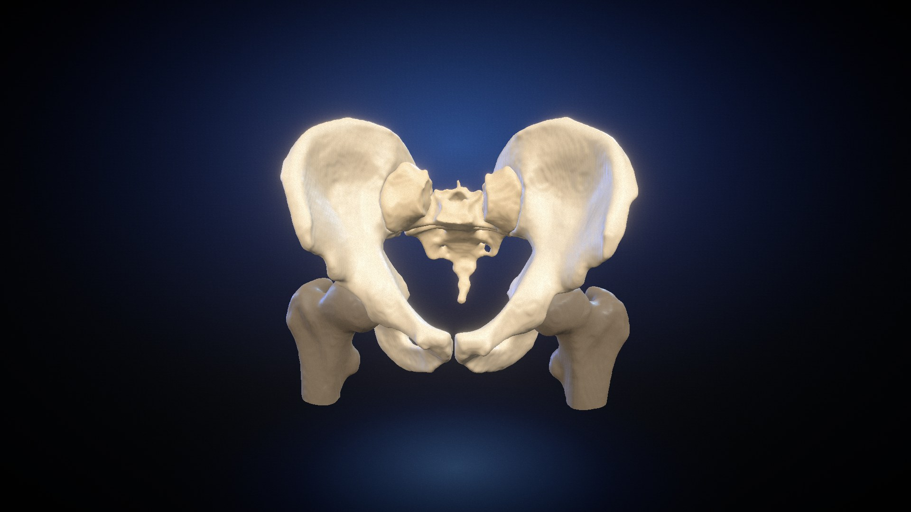
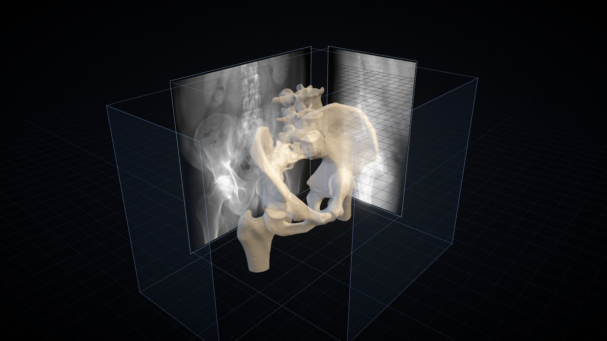
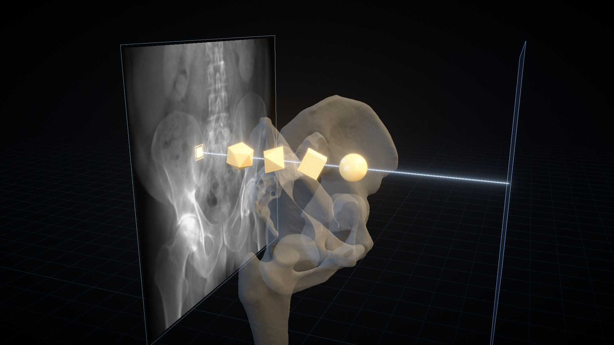
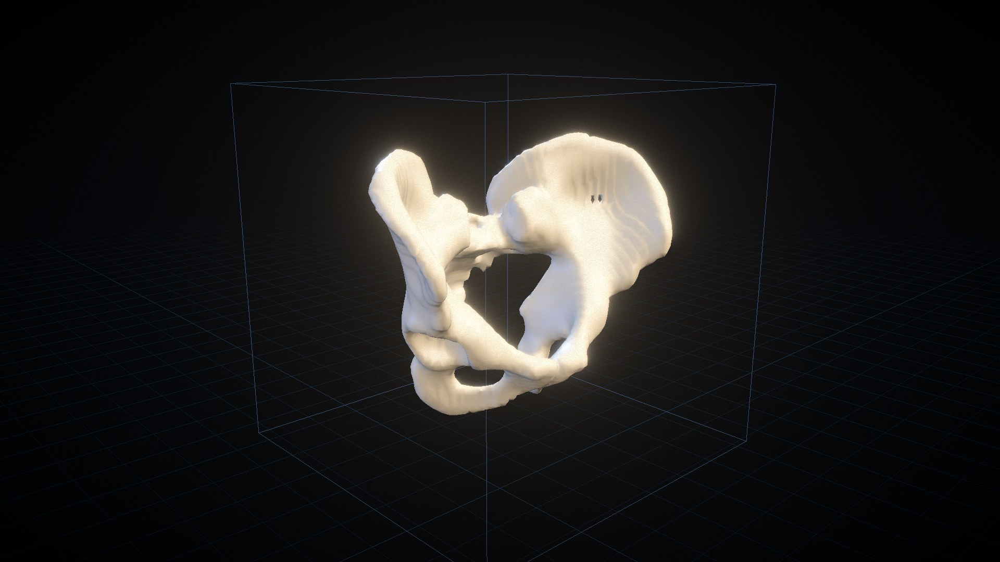
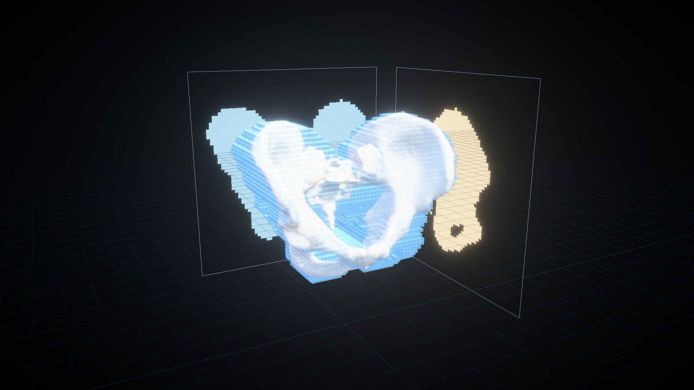

# pelvis-xray-3d

Reconstructing the 3D shape of the pelvis from two X-rays (AP + lateral) with a 2D-encoder / 3D-decoder network, and measuring how well it holds up on real X-rays rather than simulated ones.

Final project for *Intro to Computer Vision in Medical Imaging* (HIT, 2026–27), by **Adir Buskila** and **Noa Zadok**.



<table>
  <tr>
    <td width="50%"></td>
    <td width="50%"></td>
  </tr>
  <tr>
    <td><b>The rig.</b> Two simulated X-rays (AP and lateral) around the pelvis they were rendered from.</td>
    <td><b>Why one view isn't enough.</b> Every shape along a ray lands on the same pixel.</td>
  </tr>
  <tr>
    <td></td>
    <td></td>
  </tr>
  <tr>
    <td><b>The target.</b> The pelvis inside the canonical 320 mm cube the network predicts.</td>
    <td><b>The first baseline.</b> The visual hull carved from the two silhouettes (blue) around the true pelvis.</td>
  </tr>
</table>

<sub>Frames from the project's teaching videos (<a href="videos/">videos/</a>). CT data: TotalSegmentator, CC BY 4.0.</sub>

The project is built as a sequence of **learning units**. Each unit: watch a video together, implement that part of the pipeline in a guided notebook, explain it back. See [`docs/superpowers/specs/2026-11-11-project-foundation-design.md`](docs/superpowers/specs/2026-11-11-project-foundation-design.md) for how the work is organised.

## Start here

```
python -m pip install -e .          # once: makes `import xray3d` work (Anaconda prompt, from this folder)
jupyter lab units/00-setup/notebook.ipynb
pytest units                        # runs every unit's checks against src/xray3d
```

| Folder | What's in it |
|---|---|
| [`units/`](units/) | the learning units: notebook, Hebrew explainer, checks, log ([index](units/README.md)) |
| [`src/xray3d/`](src/xray3d/) | shared code: infrastructure by Claude, concept code by us once a unit's checks pass |
| [`splits/`](splits/) | the subject list and the fixed train/val/test split |
| [`data/scripts/`](data/scripts/) | download and screening scripts (the data itself is never committed) |
| [`videos/`](videos/) | the teaching video series (Remotion + three.js) |
| [`presentation/`](presentation/) | the class presentation (reveal.js) |

Rules for Claude sessions in this repo: [`CLAUDE.md`](CLAUDE.md).

## Data (not in this repo)

| Dataset | Use | License |
|---|---|---|
| [TotalSegmentator v2.0.1](https://zenodo.org/records/10047292) (and its [small subset](https://zenodo.org/records/10047263)) | training CT + bone masks | CC BY 4.0 |
| [DeepFluoro](https://huggingface.co/datasets/eigenvivek/xvr-data) (via the `xvr-data` mirror) | evaluation on real fluoroscopy | CC BY-NC-ND 4.0 |

Datasets are downloaded into `data/` (gitignored) and are never committed.
